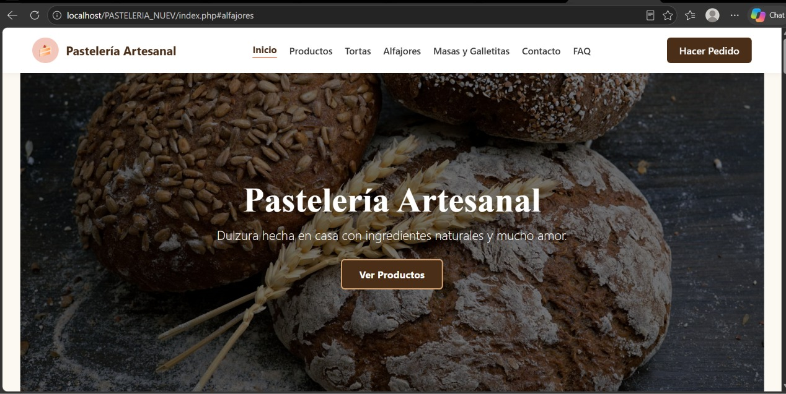

# Pastelería Artesanal — Migración a PHP (TP N° 4)
## Rodriguez Diaz Julieta
## 1. Título y Descripción del Proyecto
Proyecto **Pastelería Artesanal** evolucionado desde una maqueta estática hacia **PHP** en el marco del Trabajo Práctico N° 4 (*Migración a PHP, Modularización (SSI) y Renderizado Server-Side (SSR)*). Se implementaron plantillas modulares con `require_once` (`header.php`, `nav.php` y `footer.php`), título de página dinámico y carga de variables de entorno desde `.env` con plantilla `.env.example`.


## 3. Tecnologías Utilizadas
- HTML5
- CSS3
- JavaScript
- PHP 8.x
- Laragon (Apache / entorno local)
- Git bash y GitHub

## 4. Instrucciones de Instalación y Ejecución Local
1. Clonar el repositorio dentro de `C:\laragon\www\`:
   ```bash
   git clone <URL-DE-TU-REPOSITORIO-EN-GITHUB>
   cp .env.example .env

## 5. Evidencia de Funcionamiento
### Servidor Local Ejecutándose


### Estructura Modular (SSI)


### Navegación Dinámica


### Configuración de Variables de Entorno

## Clase 6 — Bases de Datos Relacionales en MySQL

En el directorio `clase6/` se desarrolló el modelado relacional, el script DDL y las consultas CRUD aplicadas al proyecto **Pastelería Artesanal**, probadas en MySQL local a través de Laragon y HeidiSQL.

### Archivos y Contenidos

* **`clase6/NORMALIZACION.md`:** análisis de una tabla inicial de pedidos sin normalizar y su evolución paso a paso hasta la **Tercera Forma Normal (3FN)**, eliminando campos multivalorados, dependencias parciales y dependencias transitivas, con el detalle de claves primarias (`PK`) y foráneas (`FK`) en las tablas resultantes (`roles`, `usuarios`, `categorias`, `estados_pedido`, `productos`, `pedidos` y `detalle_pedidos`).
* **`clase6/schema.sql`:** script DDL que crea la base de datos `pasteleria_artesanal_db` y las tablas normalizadas en 3FN con `INT AUTO_INCREMENT PRIMARY KEY`, restricciones `FOREIGN KEY`, campos de auditoría (`created_at` y `updated_at`) e índices explícitos (`CREATE INDEX`) sobre columnas clave de búsqueda y filtrado.
* **`clase6/consultas.sql`:** script DML con operaciones CRUD para validar el esquema con datos de prueba: inserciones (`INSERT`) en tablas maestras y entidades vinculadas por clave foránea, consultas `SELECT` con `WHERE`, `ORDER BY` e `INNER JOIN`, actualización (`UPDATE`) con `WHERE` y eliminación (`DELETE`) con `WHERE`.
## Clase 7 — Persistencia y Conexión PHP-MySQL Segura (CRUD con PDO)

Se implementó la conexión segura entre PHP y la base de datos `pasteleria_artesanal_db` mediante **PDO** (`config/conexion.php`) y un módulo de gestión en `admin/` con estética artesanal (`admin/crud.css`):

- **Conexión segura (`config/conexion.php`)**: instancia de `PDO` con `PDO::ATTR_ERRMODE => PDO::ERRMODE_EXCEPTION`, `PDO::ATTR_DEFAULT_FETCH_MODE => PDO::FETCH_ASSOC`, `PDO::ATTR_EMULATE_PREPARES => false` y manejo de excepciones con `try-catch`.
- **CRUD de productos (`admin/`)**:
  - `admin/index.php`: listado de productos con `INNER JOIN` a `categorias` y filtros seguros por **GET** (búsqueda por nombre y categoría).
  - `admin/crear.php`: alta de productos con validación en servidor y consulta preparada `INSERT`.
  - `admin/editar.php`: edición de productos existentes con consulta preparada `UPDATE`.
  - `admin/eliminar.php`: borrado seguro con consulta preparada `DELETE` y control de errores de clave foránea (`SQLSTATE[23000]` / `detalle_pedidos`).
- **Pedido rápido (`admin/pedido_rapido.php`)**: formulario por **POST** que registra el pedido y su detalle en `pedidos` y `detalle_pedidos` usando transacción (`beginTransaction`, `commit`, `rollBack`) y consultas preparadas.
- **Seguridad**: uso de sentencias preparadas en consultas y `htmlspecialchars()` en las salidas HTML para prevenir inyección SQL y XSS.