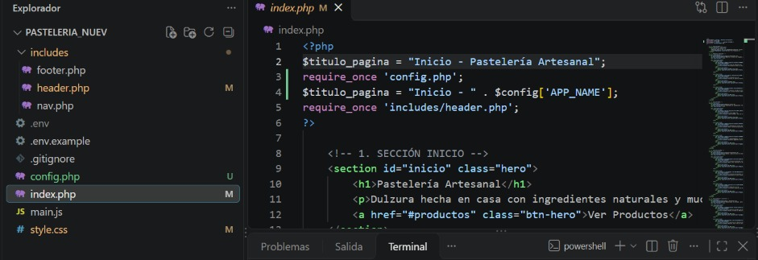
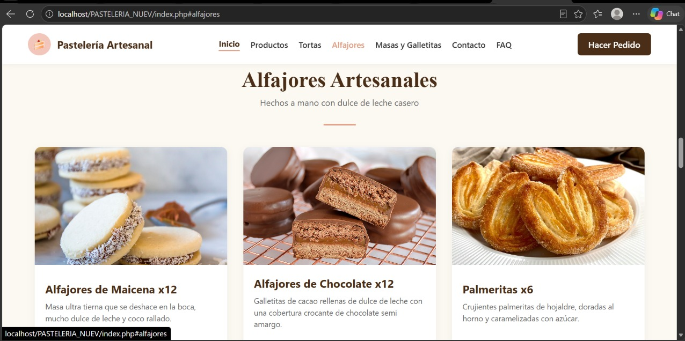
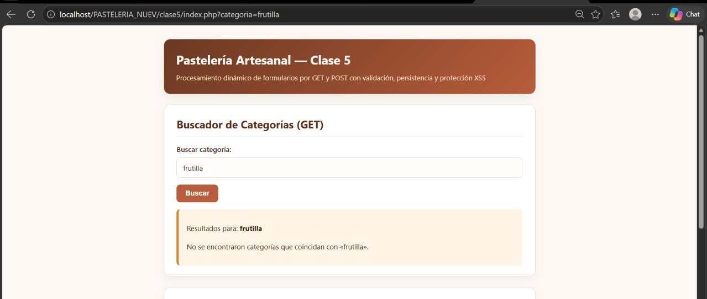
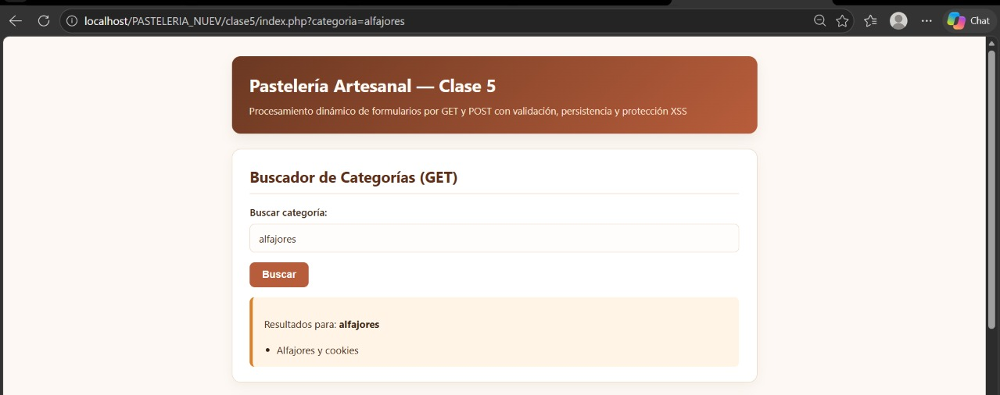
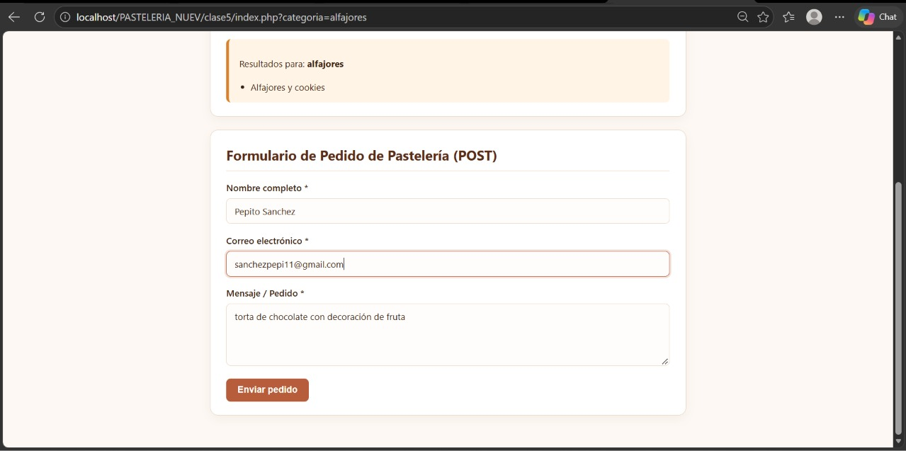
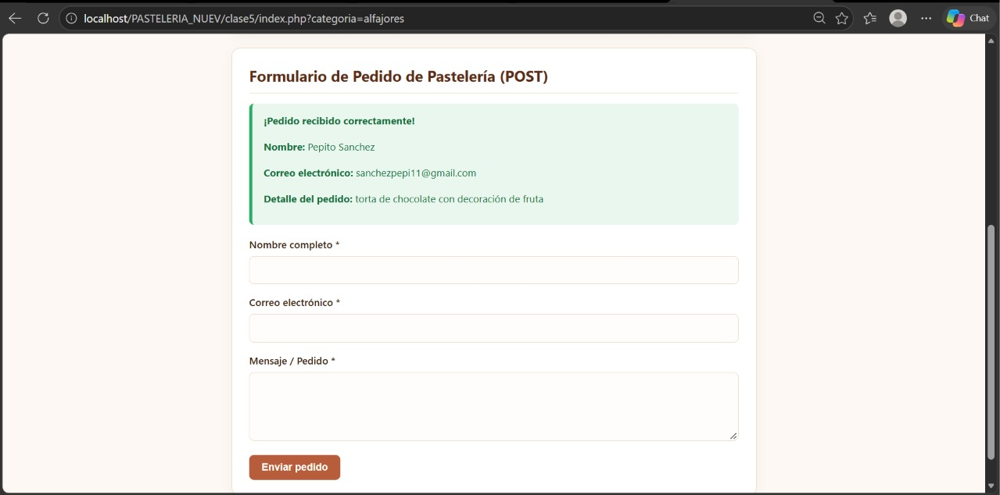
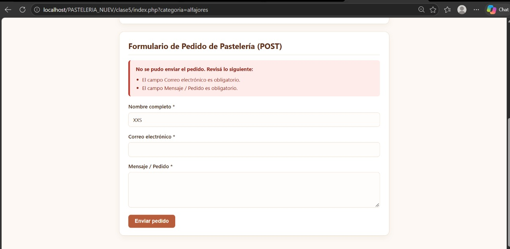

# Pastelería Artesanal — Migración a PHP (TP N° 4)
## Rodriguez Diaz Julieta
## 1. Título y Descripción del Proyecto
Proyecto **Pastelería Artesanal** evolucionado desde una maqueta estática hacia **PHP** en el marco del Trabajo Práctico N° 4 (*Migración a PHP, Modularización (SSI) y Renderizado Server-Side (SSR)*). Se implementaron plantillas modulares con `require_once` (`header.php`, `nav.php` y `footer.php`), título de página dinámico y carga de variables de entorno desde `.env` con plantilla `.env.example`.


## 3. Tecnologías Utilizadas
- HTML5
- CSS3
- JavaScript
- PHP 8.x
- Laragon (Apache / entorno local)
- Git bash y GitHub

## 4. Instrucciones de Instalación y Ejecución Local
1. Clonar el repositorio dentro de `C:\laragon\www\`:
   ```bash
   git clone <URL-DE-TU-REPOSITORIO-EN-GITHUB>
   cp .env.example .env

## 5. Evidencia de Funcionamiento
### Servidor Local Ejecutándose


### Estructura Modular (SSI)


### Navegación Dinámica


### Configuración de Variables de Entorno


## Clase 5 — Procesamiento de Formularios y Seguridad Web

En el directorio `clase5/` (`clase5/index.php` y `clase5/style.css`) se implementaron dos formularios dinámicos en PHP con validación en servidor, sanitización, persistencia de datos ante errores, protección frente a ataques XSS y diseño visual cálido adaptado a la pastelería artesanal.

### Formularios Implementados

* **Formulario por `GET` (Buscador de Categorías):** permite buscar y filtrar categorías de productos (como *Tortas artesanales*, *Tartas dulces y frutales*, *Facturas y medialunas*, *Alfajores y cookies* y *Opciones sin TACC*) mediante parámetros en la URL (`?categoria=...`), limpiando la entrada con `trim()` y escapando la salida con `htmlspecialchars(..., ENT_QUOTES, 'UTF-8')`[cite: 24, 25].
* **Formulario por `POST` (Pedido de Pastelería):** recibe *Nombre completo*, *Correo electrónico* y *Mensaje / Pedido*, verifica `$_SERVER['REQUEST_METHOD'] === 'POST'` y la presencia/no vacío de campos (`isset()`, `empty()`, `trim()`), sanitiza y valida el correo con `filter_var()` (`FILTER_SANITIZE_EMAIL` y `FILTER_VALIDATE_EMAIL`), conserva los datos ingresados si ocurren errores de validación y escapa todas las salidas para prevenir XSS[cite: 23, 26, 27].

### Evidencia de Funcionamiento

#### Búsqueda GET sin coincidencias (`captura5.jpeg`)
[cite: 24]

#### Búsqueda GET con resultado encontrado (`captura6.jpeg`)
[cite: 25]

#### Formulario POST completado antes del envío (`captura7.jpeg`)
[cite: 26]

#### Confirmación de envío POST exitoso (`captura8.jpeg`)
[cite: 27]

#### Validación de errores y persistencia de datos en POST (`captura9.jpeg`)
[cite: 23]