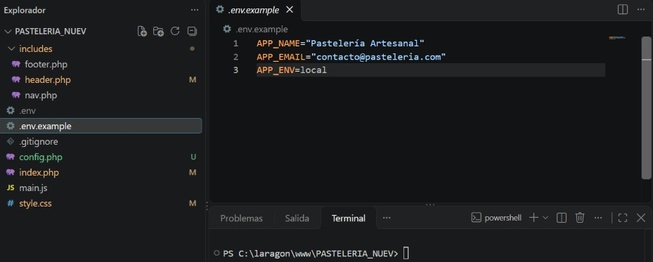

# Pastelería Artesanal — Migración a PHP (TP N° 4)

## 1. Título y Descripción del Proyecto
Proyecto **Pastelería Artesanal** evolucionado desde una maqueta estática hacia **PHP** en el marco del Trabajo Práctico N° 4 (*Migración a PHP, Modularización (SSI) y Renderizado Server-Side (SSR)*). Se implementaron plantillas modulares con `require_once` (`header.php`, `nav.php` y `footer.php`), título de página dinámico y carga de variables de entorno desde `.env` con plantilla `.env.example`.


## 3. Tecnologías Utilizadas
- HTML5
- CSS3
- JavaScript
- PHP 8.x
- Laragon (Apache / entorno local)
- Git bash y GitHub

## 4. Instrucciones de Instalación y Ejecución Local
1. Clonar el repositorio dentro de `C:\laragon\www\`:
   ```bash
   git clone <URL-DE-TU-REPOSITORIO-EN-GITHUB>
   cp .env.example .env

## 5. Evidencia de Funcionamiento
### Servidor Local Ejecutándose


### Estructura Modular (SSI)


### Navegación Dinámica


### Configuración de Variables de Entorno
